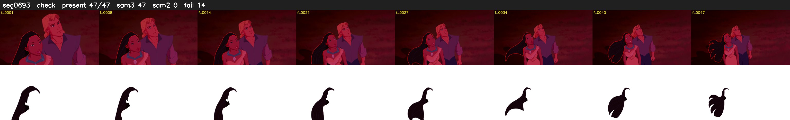

# Segment 693 (shot)

Film frames 60074-60120 (47 frames, 42:45.6-42:47.5).

**Status: check**

| | |
|---|---|
| Frames with her hair | 47 / 47 |
| Mask source | SAM3 47, SAM2 fallback 0 |
| Frames still failing QC | 14 [28, 30, 31, 32, 33, 34, 35, 36, 37, 38, 39, 41, 42, 43] |
| Film indices with no picture (held) | 0 |
| Time | 68 s |

Top: source with the final mask outlined in red. Bottom: white-fill output.
