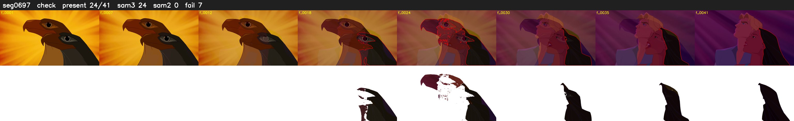

# Segment 697 (transition)

Film frames 60226-60266 (41 frames, 42:51.9-42:53.6).

**Status: check**

| | |
|---|---|
| Frames with her hair | 24 / 41 |
| Mask source | SAM3 24, SAM2 fallback 0 |
| Frames still failing QC | 7 [18, 21, 22, 23, 24, 25, 26] |
| Film indices with no picture (held) | 0 |
| Time | 76 s |

Top: source with the final mask outlined in red. Bottom: white-fill output.

## Issues

- other characters' hair erased on 20 frames
