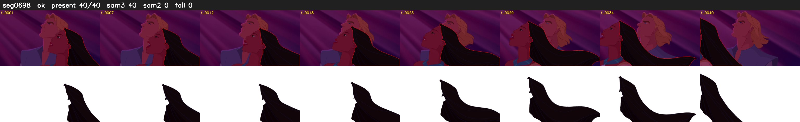

# Segment 698 (shot)

Film frames 60267-60306 (40 frames, 42:53.6-42:55.3).

**Status: ok**

| | |
|---|---|
| Frames with her hair | 40 / 40 |
| Mask source | SAM3 40, SAM2 fallback 0 |
| Frames still failing QC | 0 [] |
| Film indices with no picture (held) | 0 |
| Time | 61 s |

Top: source with the final mask outlined in red. Bottom: white-fill output.
