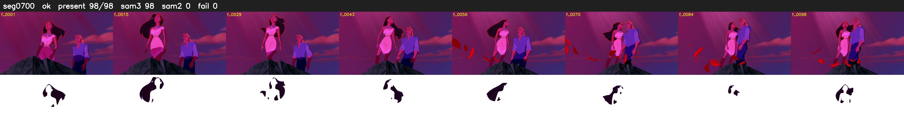

# Segment 700 (shot)

Film frames 60369-60466 (98 frames, 42:57.9-42:02.0).

**Status: ok**

| | |
|---|---|
| Frames with her hair | 98 / 98 |
| Mask source | SAM3 98, SAM2 fallback 0 |
| Frames still failing QC | 0 [] |
| Film indices with no picture (held) | 0 |
| Time | 147 s |

Top: source with the final mask outlined in red. Bottom: white-fill output.

## Issues

- dusk scene: median hair purity 0.72 < 0.75, purity QC off
