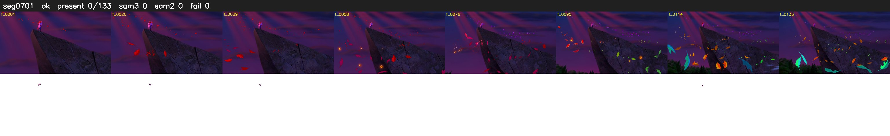

# Segment 701 (shot)

Film frames 60467-60599 (133 frames, 42:02.0-42:07.5).

**Status: ok**

| | |
|---|---|
| Frames with her hair | 0 / 133 |
| Mask source | SAM3 0, SAM2 fallback 0 |
| Frames still failing QC | 0 [] |
| Film indices with no picture (held) | 0 |
| Time | 213 s |

Top: source with the final mask outlined in red. Bottom: white-fill output.
