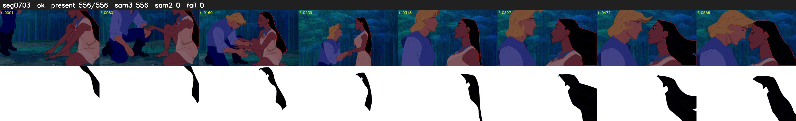

# Segment 703 (shot)

Film frames 60702-61257 (556 frames, 42:11.8-43:35.0).

**Status: ok**

| | |
|---|---|
| Frames with her hair | 556 / 556 |
| Mask source | SAM3 556, SAM2 fallback 0 |
| Frames still failing QC | 0 [] |
| Film indices with no picture (held) | 0 |
| Time | 849 s |

Top: source with the final mask outlined in red. Bottom: white-fill output.
