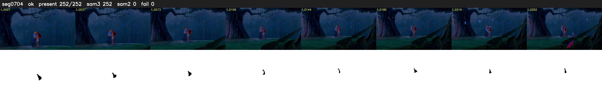

# Segment 704 (shot)

Film frames 61258-61509 (252 frames, 43:35.0-43:45.5).

**Status: ok**

| | |
|---|---|
| Frames with her hair | 252 / 252 |
| Mask source | SAM3 252, SAM2 fallback 0 |
| Frames still failing QC | 0 [] |
| Film indices with no picture (held) | 0 |
| Time | 390 s |

Top: source with the final mask outlined in red. Bottom: white-fill output.
