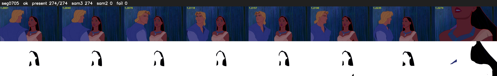

# Segment 705 (shot)

Film frames 61510-61783 (274 frames, 43:45.5-43:56.9).

**Status: ok**

| | |
|---|---|
| Frames with her hair | 274 / 274 |
| Mask source | SAM3 274, SAM2 fallback 0 |
| Frames still failing QC | 0 [] |
| Film indices with no picture (held) | 0 |
| Time | 438 s |

Top: source with the final mask outlined in red. Bottom: white-fill output.
