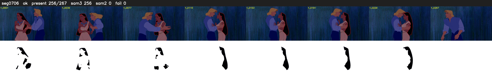

# Segment 706 (shot)

Film frames 61784-62050 (267 frames, 43:56.9-43:08.0).

**Status: ok**

| | |
|---|---|
| Frames with her hair | 256 / 267 |
| Mask source | SAM3 256, SAM2 fallback 0 |
| Frames still failing QC | 0 [] |
| Film indices with no picture (held) | 0 |
| Time | 425 s |

Top: source with the final mask outlined in red. Bottom: white-fill output.

## Issues

- other characters' hair erased on 11 frames
