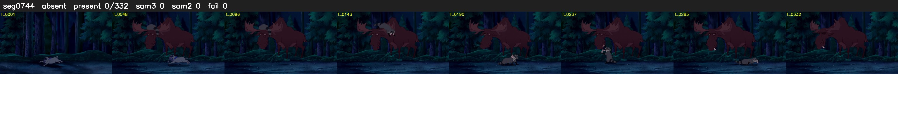

# Segment 744 (shot)

Film frames 65294-65625 (332 frames, 45:23.3-46:37.2).

**Status: absent**

| | |
|---|---|
| Frames with her hair | 0 / 332 |
| Mask source | SAM3 0, SAM2 fallback 0 |
| Frames still failing QC | 0 [] |
| Film indices with no picture (held) | 0 |
| Time | 108 s |

Top: source with the final mask outlined in red. Bottom: white-fill output.

## Issues

- hair on 42/56 presence frames, none of it hers (best P 0.02)
