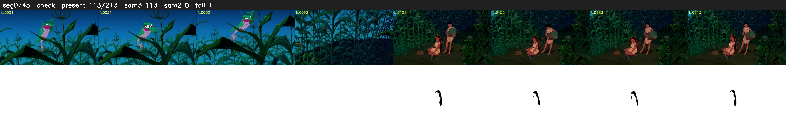

# Segment 745 (shot)

Film frames 65626-65838 (213 frames, 46:37.2-46:46.0).

**Status: check**

| | |
|---|---|
| Frames with her hair | 113 / 213 |
| Mask source | SAM3 113, SAM2 fallback 0 |
| Frames still failing QC | 1 [101] |
| Film indices with no picture (held) | 0 |
| Time | 444 s |

Top: source with the final mask outlined in red. Bottom: white-fill output.

## SAM2 fallbacks

| Frames | Anchor | Direction | SAM2 used |
|---|---|---|---|
| 101-101 | 102 | backward | 0/1 |

## Issues

- other characters' hair erased on 187 frames
