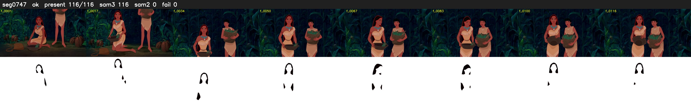

# Segment 747 (shot)

Film frames 65910-66025 (116 frames, 46:49.0-46:53.8).

**Status: ok**

| | |
|---|---|
| Frames with her hair | 116 / 116 |
| Mask source | SAM3 116, SAM2 fallback 0 |
| Frames still failing QC | 0 [] |
| Film indices with no picture (held) | 0 |
| Time | 244 s |

Top: source with the final mask outlined in red. Bottom: white-fill output.

## Issues

- dark scene: 87% of frames fail 'missed', missed QC off
- other characters' hair erased on 93 frames
