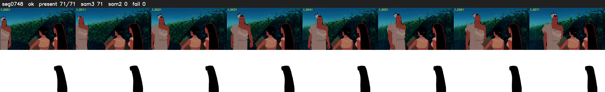

# Segment 748 (shot)

Film frames 66026-66096 (71 frames, 46:53.8-46:56.8).

**Status: ok**

| | |
|---|---|
| Frames with her hair | 71 / 71 |
| Mask source | SAM3 71, SAM2 fallback 0 |
| Frames still failing QC | 0 [] |
| Film indices with no picture (held) | 0 |
| Time | 196 s |

Top: source with the final mask outlined in red. Bottom: white-fill output.

## Issues

- dark scene: 100% of frames fail 'missed', missed QC off
- other characters' hair erased on 71 frames
