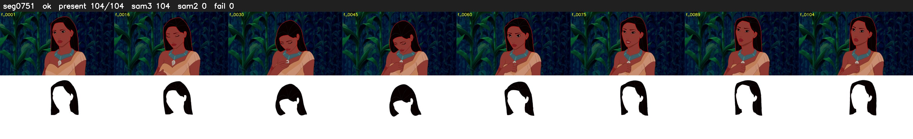

# Segment 751 (shot)

Film frames 66231-66334 (104 frames, 46:02.4-46:06.7).

**Status: ok**

| | |
|---|---|
| Frames with her hair | 104 / 104 |
| Mask source | SAM3 104, SAM2 fallback 0 |
| Frames still failing QC | 0 [] |
| Film indices with no picture (held) | 0 |
| Time | 163 s |

Top: source with the final mask outlined in red. Bottom: white-fill output.
