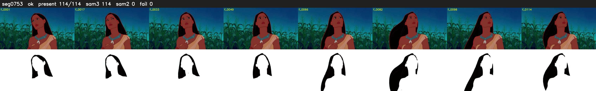

# Segment 753 (shot)

Film frames 66452-66565 (114 frames, 46:11.6-46:16.4).

**Status: ok**

| | |
|---|---|
| Frames with her hair | 114 / 114 |
| Mask source | SAM3 114, SAM2 fallback 0 |
| Frames still failing QC | 0 [] |
| Film indices with no picture (held) | 0 |
| Time | 174 s |

Top: source with the final mask outlined in red. Bottom: white-fill output.
