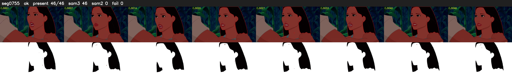

# Segment 755 (shot)

Film frames 66632-66677 (46 frames, 46:19.1-46:21.0).

**Status: ok**

| | |
|---|---|
| Frames with her hair | 46 / 46 |
| Mask source | SAM3 46, SAM2 fallback 0 |
| Frames still failing QC | 0 [] |
| Film indices with no picture (held) | 0 |
| Time | 71 s |

Top: source with the final mask outlined in red. Bottom: white-fill output.
