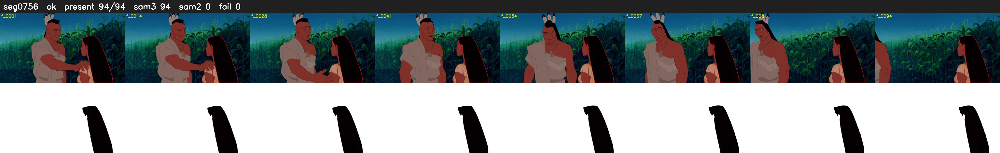

# Segment 756 (shot)

Film frames 66678-66771 (94 frames, 46:21.0-46:24.9).

**Status: ok**

| | |
|---|---|
| Frames with her hair | 94 / 94 |
| Mask source | SAM3 94, SAM2 fallback 0 |
| Frames still failing QC | 0 [] |
| Film indices with no picture (held) | 0 |
| Time | 222 s |

Top: source with the final mask outlined in red. Bottom: white-fill output.

## Issues

- dark scene: 100% of frames fail 'missed', missed QC off
- other characters' hair erased on 94 frames
