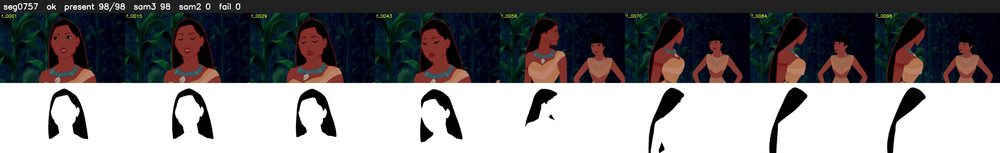

# Segment 757 (shot)

Film frames 66772-66869 (98 frames, 46:24.9-46:29.0).

**Status: ok**

| | |
|---|---|
| Frames with her hair | 98 / 98 |
| Mask source | SAM3 98, SAM2 fallback 0 |
| Frames still failing QC | 0 [] |
| Film indices with no picture (held) | 0 |
| Time | 181 s |

Top: source with the final mask outlined in red. Bottom: white-fill output.

## Issues

- dark scene: 57% of frames fail 'missed', missed QC off
- other characters' hair erased on 49 frames
