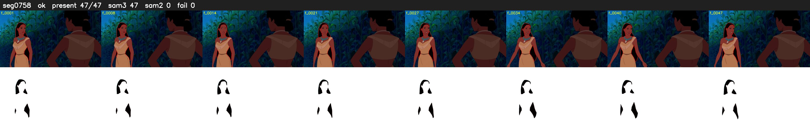

# Segment 758 (shot)

Film frames 66870-66916 (47 frames, 46:29.0-47:31.0).

**Status: ok**

| | |
|---|---|
| Frames with her hair | 47 / 47 |
| Mask source | SAM3 47, SAM2 fallback 0 |
| Frames still failing QC | 0 [] |
| Film indices with no picture (held) | 0 |
| Time | 98 s |

Top: source with the final mask outlined in red. Bottom: white-fill output.

## Issues

- other characters' hair erased on 47 frames
