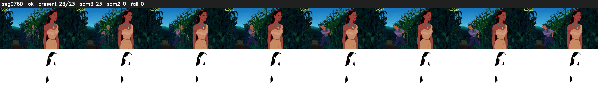

# Segment 760 (shot)

Film frames 66970-66992 (23 frames, 47:33.2-47:34.2).

**Status: ok**

| | |
|---|---|
| Frames with her hair | 23 / 23 |
| Mask source | SAM3 23, SAM2 fallback 0 |
| Frames still failing QC | 0 [] |
| Film indices with no picture (held) | 0 |
| Time | 39 s |

Top: source with the final mask outlined in red. Bottom: white-fill output.

## Issues

- dark scene: 100% of frames fail 'missed', missed QC off
