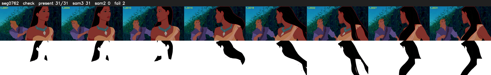

# Segment 762 (shot)

Film frames 67037-67067 (31 frames, 47:36.0-47:37.3).

**Status: check**

| | |
|---|---|
| Frames with her hair | 31 / 31 |
| Mask source | SAM3 31, SAM2 fallback 0 |
| Frames still failing QC | 2 [12, 19] |
| Film indices with no picture (held) | 0 |
| Time | 58 s |

Top: source with the final mask outlined in red. Bottom: white-fill output.

## SAM2 fallbacks

| Frames | Anchor | Direction | SAM2 used |
|---|---|---|---|
| 12-12 | 11 | forward | 0/1 |
| 19-19 | 18 | forward | 0/1 |
