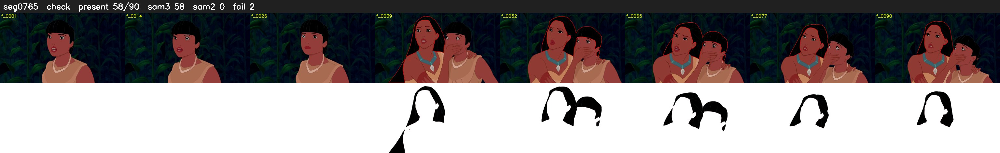

# Segment 765 (shot)

Film frames 67148-67237 (90 frames, 47:40.6-47:44.4).

**Status: check**

| | |
|---|---|
| Frames with her hair | 58 / 90 |
| Mask source | SAM3 58, SAM2 fallback 0 |
| Frames still failing QC | 2 [33, 51] |
| Film indices with no picture (held) | 0 |
| Time | 170 s |

Top: source with the final mask outlined in red. Bottom: white-fill output.

## Issues

- dark scene: 72% of frames fail 'missed', missed QC off
- other characters' hair erased on 69 frames
