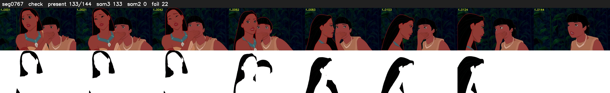

# Segment 767 (shot)

Film frames 67265-67408 (144 frames, 47:45.5-47:51.5).

**Status: check**

| | |
|---|---|
| Frames with her hair | 133 / 144 |
| Mask source | SAM3 133, SAM2 fallback 0 |
| Frames still failing QC | 22 [1, 2, 3, 4, 5, 6, 7, 8, 9, 10, 11, 12, 13, 14, 15, 16, 17, 18, 19, 20] |
| Film indices with no picture (held) | 0 |
| Time | 326 s |

Top: source with the final mask outlined in red. Bottom: white-fill output.

## Issues

- other characters' hair erased on 126 frames
