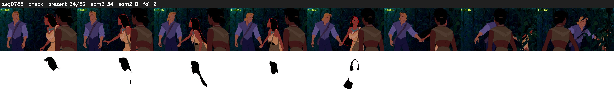

# Segment 768 (shot)

Film frames 67409-67460 (52 frames, 47:51.5-47:53.7).

**Status: check**

| | |
|---|---|
| Frames with her hair | 34 / 52 |
| Mask source | SAM3 34, SAM2 fallback 0 |
| Frames still failing QC | 2 [33, 34] |
| Film indices with no picture (held) | 0 |
| Time | 112 s |

Top: source with the final mask outlined in red. Bottom: white-fill output.

## Issues

- dark scene: 100% of frames fail 'missed', missed QC off
- other characters' hair erased on 50 frames
