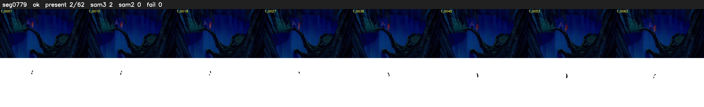

# Segment 779 (shot)

Film frames 68334-68395 (62 frames, 48:30.1-48:32.7).

**Status: ok**

| | |
|---|---|
| Frames with her hair | 2 / 62 |
| Mask source | SAM3 2, SAM2 fallback 0 |
| Frames still failing QC | 0 [] |
| Film indices with no picture (held) | 0 |
| Time | 105 s |

Top: source with the final mask outlined in red. Bottom: white-fill output.
