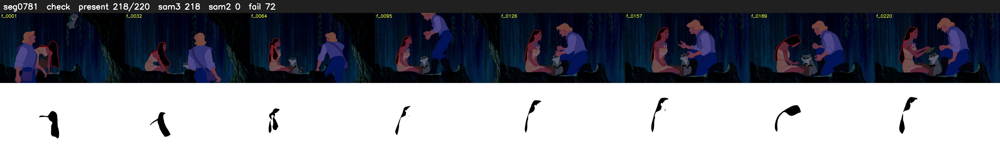

# Segment 781 (shot)

Film frames 68433-68652 (220 frames, 48:34.2-48:43.4).

**Status: check**

| | |
|---|---|
| Frames with her hair | 218 / 220 |
| Mask source | SAM3 218, SAM2 fallback 0 |
| Frames still failing QC | 72 [17, 18, 127, 128, 129, 130, 131, 132, 133, 134, 135, 136, 137, 138, 139, 140, 141, 142, 143, 144] |
| Film indices with no picture (held) | 0 |
| Time | 346 s |

Top: source with the final mask outlined in red. Bottom: white-fill output.

## Issues

- other characters' hair erased on 2 frames
