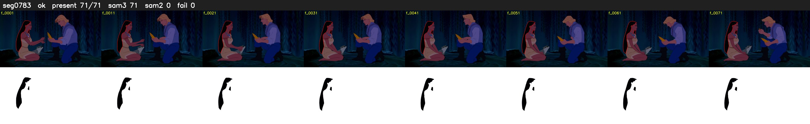

# Segment 783 (shot)

Film frames 68710-68780 (71 frames, 48:45.8-48:48.7).

**Status: ok**

| | |
|---|---|
| Frames with her hair | 71 / 71 |
| Mask source | SAM3 71, SAM2 fallback 0 |
| Frames still failing QC | 0 [] |
| Film indices with no picture (held) | 0 |
| Time | 109 s |

Top: source with the final mask outlined in red. Bottom: white-fill output.

## Issues

- dark scene: 100% of frames fail 'missed', missed QC off
