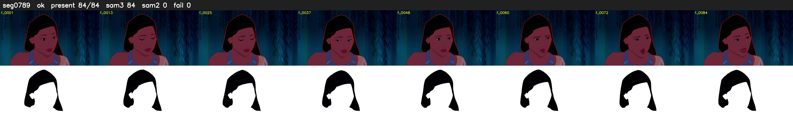

# Segment 789 (shot)

Film frames 69124-69207 (84 frames, 48:03.0-48:06.6).

**Status: ok**

| | |
|---|---|
| Frames with her hair | 84 / 84 |
| Mask source | SAM3 84, SAM2 fallback 0 |
| Frames still failing QC | 0 [] |
| Film indices with no picture (held) | 0 |
| Time | 126 s |

Top: source with the final mask outlined in red. Bottom: white-fill output.
