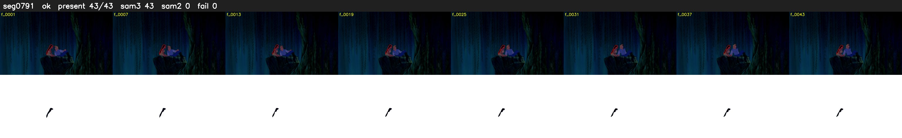

# Segment 791 (shot)

Film frames 69420-69462 (43 frames, 48:15.4-48:17.2).

**Status: ok**

| | |
|---|---|
| Frames with her hair | 43 / 43 |
| Mask source | SAM3 43, SAM2 fallback 0 |
| Frames still failing QC | 0 [] |
| Film indices with no picture (held) | 0 |
| Time | 65 s |

Top: source with the final mask outlined in red. Bottom: white-fill output.
