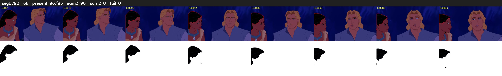

# Segment 792 (shot)

Film frames 69463-69558 (96 frames, 48:17.2-48:21.2).

**Status: ok**

| | |
|---|---|
| Frames with her hair | 96 / 96 |
| Mask source | SAM3 96, SAM2 fallback 0 |
| Frames still failing QC | 0 [] |
| Film indices with no picture (held) | 0 |
| Time | 141 s |

Top: source with the final mask outlined in red. Bottom: white-fill output.
