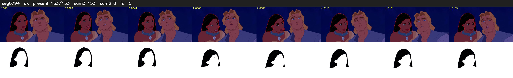

# Segment 794 (shot)

Film frames 69615-69767 (153 frames, 48:23.5-48:29.9).

**Status: ok**

| | |
|---|---|
| Frames with her hair | 153 / 153 |
| Mask source | SAM3 153, SAM2 fallback 0 |
| Frames still failing QC | 0 [] |
| Film indices with no picture (held) | 0 |
| Time | 222 s |

Top: source with the final mask outlined in red. Bottom: white-fill output.
