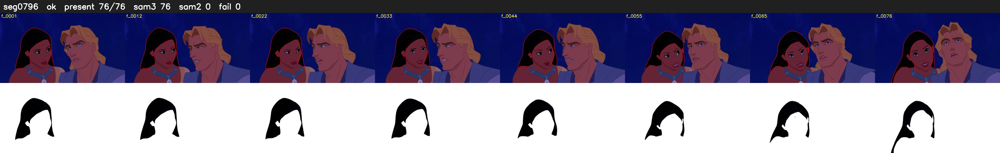

# Segment 796 (shot)

Film frames 69808-69883 (76 frames, 49:31.6-49:34.7).

**Status: ok**

| | |
|---|---|
| Frames with her hair | 76 / 76 |
| Mask source | SAM3 76, SAM2 fallback 0 |
| Frames still failing QC | 0 [] |
| Film indices with no picture (held) | 0 |
| Time | 110 s |

Top: source with the final mask outlined in red. Bottom: white-fill output.
