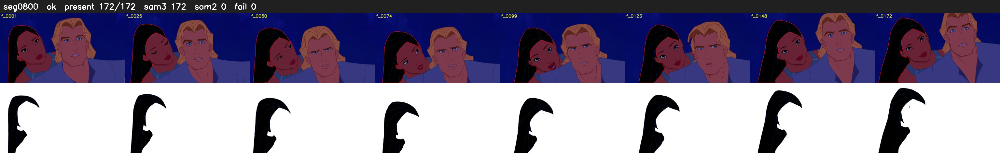

# Segment 800 (shot)

Film frames 70188-70359 (172 frames, 49:47.4-49:54.6).

**Status: ok**

| | |
|---|---|
| Frames with her hair | 172 / 172 |
| Mask source | SAM3 172, SAM2 fallback 0 |
| Frames still failing QC | 0 [] |
| Film indices with no picture (held) | 0 |
| Time | 248 s |

Top: source with the final mask outlined in red. Bottom: white-fill output.
