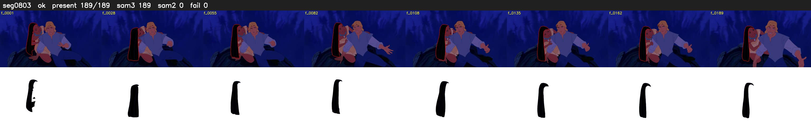

# Segment 803 (shot)

Film frames 70463-70651 (189 frames, 49:58.9-49:06.8).

**Status: ok**

| | |
|---|---|
| Frames with her hair | 189 / 189 |
| Mask source | SAM3 189, SAM2 fallback 0 |
| Frames still failing QC | 0 [] |
| Film indices with no picture (held) | 0 |
| Time | 286 s |

Top: source with the final mask outlined in red. Bottom: white-fill output.

## Issues

- dark scene: 75% of frames fail 'missed', missed QC off
