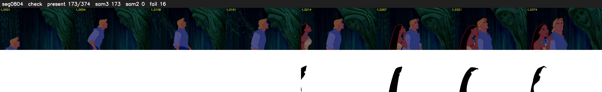

# Segment 804 (shot)

Film frames 70652-71025 (374 frames, 49:06.8-49:22.4).

**Status: check**

| | |
|---|---|
| Frames with her hair | 173 / 374 |
| Mask source | SAM3 173, SAM2 fallback 0 |
| Frames still failing QC | 16 [67, 68, 69, 70, 71, 72, 73, 74, 75, 76, 77, 78, 79, 80, 207, 208] |
| Film indices with no picture (held) | 0 |
| Time | 605 s |

Top: source with the final mask outlined in red. Bottom: white-fill output.

## Issues

- other characters' hair erased on 189 frames
