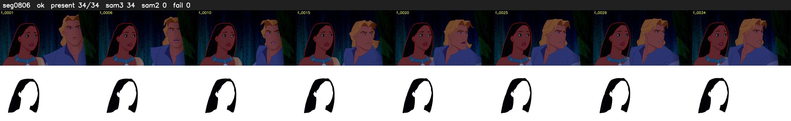

# Segment 806 (shot)

Film frames 71081-71114 (34 frames, 49:24.7-49:26.1).

**Status: ok**

| | |
|---|---|
| Frames with her hair | 34 / 34 |
| Mask source | SAM3 34, SAM2 fallback 0 |
| Frames still failing QC | 0 [] |
| Film indices with no picture (held) | 0 |
| Time | 50 s |

Top: source with the final mask outlined in red. Bottom: white-fill output.
