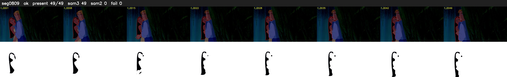

# Segment 809 (shot)

Film frames 71263-71311 (49 frames, 50:32.3-50:34.3).

**Status: ok**

| | |
|---|---|
| Frames with her hair | 49 / 49 |
| Mask source | SAM3 49, SAM2 fallback 0 |
| Frames still failing QC | 0 [] |
| Film indices with no picture (held) | 0 |
| Time | 73 s |

Top: source with the final mask outlined in red. Bottom: white-fill output.
