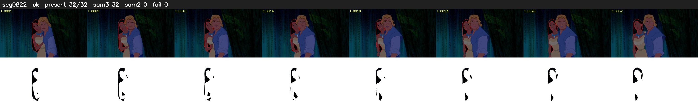

# Segment 822 (shot)

Film frames 71862-71893 (32 frames, 50:57.2-50:58.6).

**Status: ok**

| | |
|---|---|
| Frames with her hair | 32 / 32 |
| Mask source | SAM3 32, SAM2 fallback 0 |
| Frames still failing QC | 0 [] |
| Film indices with no picture (held) | 0 |
| Time | 51 s |

Top: source with the final mask outlined in red. Bottom: white-fill output.
