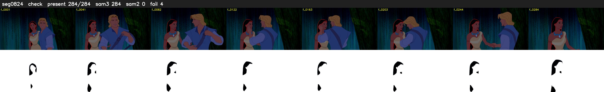

# Segment 824 (shot)

Film frames 71968-72251 (284 frames, 50:01.7-50:13.5).

**Status: check**

| | |
|---|---|
| Frames with her hair | 284 / 284 |
| Mask source | SAM3 284, SAM2 fallback 0 |
| Frames still failing QC | 4 [251, 252, 253, 254] |
| Film indices with no picture (held) | 0 |
| Time | 520 s |

Top: source with the final mask outlined in red. Bottom: white-fill output.
