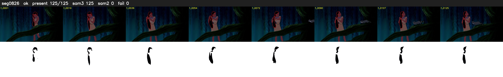

# Segment 826 (shot)

Film frames 72368-72492 (125 frames, 50:18.3-50:23.6).

**Status: ok**

| | |
|---|---|
| Frames with her hair | 125 / 125 |
| Mask source | SAM3 125, SAM2 fallback 0 |
| Frames still failing QC | 0 [] |
| Film indices with no picture (held) | 0 |
| Time | 189 s |

Top: source with the final mask outlined in red. Bottom: white-fill output.
