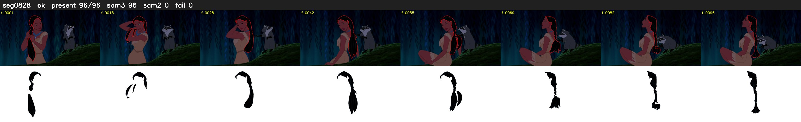

# Segment 828 (shot)

Film frames 72568-72663 (96 frames, 50:26.7-51:30.7).

**Status: ok**

| | |
|---|---|
| Frames with her hair | 96 / 96 |
| Mask source | SAM3 96, SAM2 fallback 0 |
| Frames still failing QC | 0 [] |
| Film indices with no picture (held) | 0 |
| Time | 145 s |

Top: source with the final mask outlined in red. Bottom: white-fill output.
