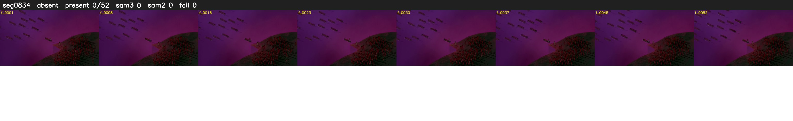

# Segment 834 (shot)

Film frames 73091-73142 (52 frames, 51:48.5-51:50.7).

**Status: absent**

| | |
|---|---|
| Frames with her hair | 0 / 52 |
| Mask source | SAM3 0, SAM2 fallback 0 |
| Frames still failing QC | 0 [] |
| Film indices with no picture (held) | 0 |
| Time | 31 s |

Top: source with the final mask outlined in red. Bottom: white-fill output.
