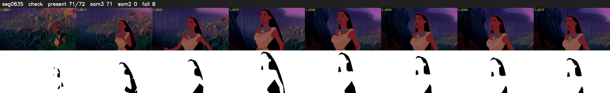

# Segment 835 (shot)

Film frames 73143-73214 (72 frames, 51:50.7-51:53.7).

**Status: check**

| | |
|---|---|
| Frames with her hair | 71 / 72 |
| Mask source | SAM3 71, SAM2 fallback 0 |
| Frames still failing QC | 8 [1, 2, 3, 4, 5, 6, 7, 9] |
| Film indices with no picture (held) | 0 |
| Time | 113 s |

Top: source with the final mask outlined in red. Bottom: white-fill output.

## Issues

- other characters' hair erased on 1 frames
