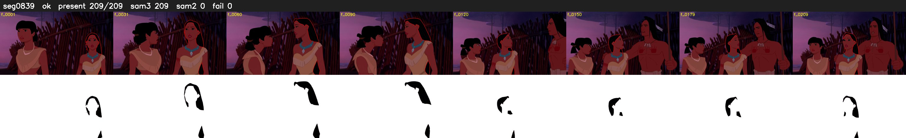

# Segment 839 (shot)

Film frames 73334-73542 (209 frames, 51:58.6-51:07.4).

**Status: ok**

| | |
|---|---|
| Frames with her hair | 209 / 209 |
| Mask source | SAM3 209, SAM2 fallback 0 |
| Frames still failing QC | 0 [] |
| Film indices with no picture (held) | 0 |
| Time | 551 s |

Top: source with the final mask outlined in red. Bottom: white-fill output.

## Issues

- dark scene: 98% of frames fail 'missed', missed QC off
- other characters' hair erased on 209 frames
