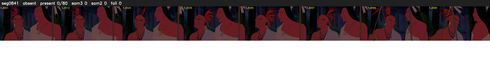

# Segment 841 (shot)

Film frames 73677-73756 (80 frames, 51:12.9-51:16.3).

**Status: absent**

| | |
|---|---|
| Frames with her hair | 0 / 80 |
| Mask source | SAM3 0, SAM2 fallback 0 |
| Frames still failing QC | 0 [] |
| Film indices with no picture (held) | 0 |
| Time | 24 s |

Top: source with the final mask outlined in red. Bottom: white-fill output.

## Issues

- hair on 14/14 presence frames, none of it hers (best P 0.10)
