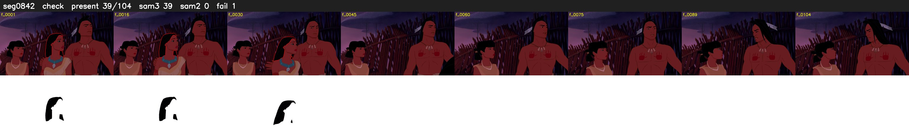

# Segment 842 (shot)

Film frames 73757-73860 (104 frames, 51:16.3-51:20.6).

**Status: check**

| | |
|---|---|
| Frames with her hair | 39 / 104 |
| Mask source | SAM3 39, SAM2 fallback 0 |
| Frames still failing QC | 1 [39] |
| Film indices with no picture (held) | 0 |
| Time | 238 s |

Top: source with the final mask outlined in red. Bottom: white-fill output.

## Issues

- dark scene: 100% of frames fail 'missed', missed QC off
- other characters' hair erased on 104 frames
