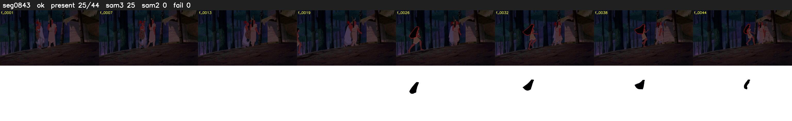

# Segment 843 (shot)

Film frames 73861-73904 (44 frames, 51:20.6-51:22.5).

**Status: ok**

| | |
|---|---|
| Frames with her hair | 25 / 44 |
| Mask source | SAM3 25, SAM2 fallback 0 |
| Frames still failing QC | 0 [] |
| Film indices with no picture (held) | 0 |
| Time | 93 s |

Top: source with the final mask outlined in red. Bottom: white-fill output.

## Issues

- other characters' hair erased on 44 frames
