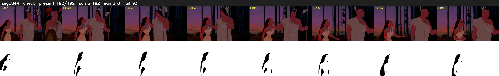

# Segment 844 (shot)

Film frames 73905-74096 (192 frames, 51:22.5-52:30.5).

**Status: check**

| | |
|---|---|
| Frames with her hair | 192 / 192 |
| Mask source | SAM3 192, SAM2 fallback 0 |
| Frames still failing QC | 93 [4, 5, 6, 7, 8, 9, 10, 11, 12, 109, 110, 111, 112, 113, 114, 115, 116, 117, 118, 119] |
| Film indices with no picture (held) | 0 |
| Time | 403 s |

Top: source with the final mask outlined in red. Bottom: white-fill output.

## Issues

- other characters' hair erased on 192 frames
