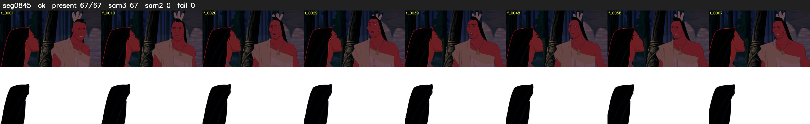

# Segment 845 (shot)

Film frames 74097-74163 (67 frames, 52:30.5-52:33.3).

**Status: ok**

| | |
|---|---|
| Frames with her hair | 67 / 67 |
| Mask source | SAM3 67, SAM2 fallback 0 |
| Frames still failing QC | 0 [] |
| Film indices with no picture (held) | 0 |
| Time | 140 s |

Top: source with the final mask outlined in red. Bottom: white-fill output.

## Issues

- dark scene: 100% of frames fail 'missed', missed QC off
- other characters' hair erased on 67 frames
