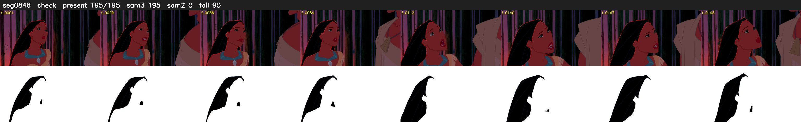

# Segment 846 (shot)

Film frames 74164-74358 (195 frames, 52:33.3-52:41.4).

**Status: check**

| | |
|---|---|
| Frames with her hair | 195 / 195 |
| Mask source | SAM3 195, SAM2 fallback 0 |
| Frames still failing QC | 90 [106, 107, 108, 109, 110, 111, 112, 113, 114, 115, 116, 117, 118, 119, 120, 121, 122, 123, 124, 125] |
| Film indices with no picture (held) | 0 |
| Time | 286 s |

Top: source with the final mask outlined in red. Bottom: white-fill output.
